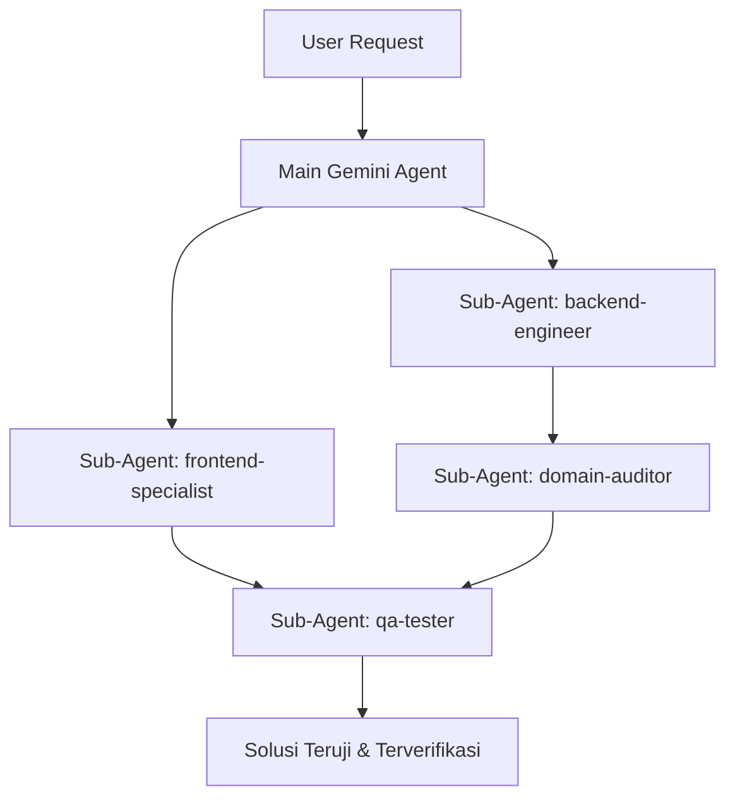

# Ekosistem Sub-Agent & Skills GudangToko

Dokumen ini mendefinisikan ekosistem spesialis sub-agent dan skills yang tersedia di workspace **GudangToko** untuk mempercepat proses pengembangan, pengujian, dan penjaminan mutu oleh AI Agent (Gemini).

---

## 1. Daftar Sub-Agent Tersedia

| Sub-Agent | Role | Scope Utama | Write Tools |
|---|---|---|:---:|
| `backend-engineer` | **Laravel 12 Backend & Domain Specialist** | Controllers, Services, Actions, Eloquent Models, FormRequests, Migrations, DB Transactions & Row-Locking, Strict Decimals (`decimal(18,2)` & `decimal(18,4)`), Enums. | ✅ Ya |
| `frontend-specialist` | **Metronic 8 & Blade UI Specialist** | View Blade, komponen `<x-metronic.*>`, modal dialog, DataTables, Select2, SweetAlert2, Vite bundler, pencegahan halaman blank (wajib `@extends` & no nested slot). | ✅ Ya |
| `qa-tester` | **Quality Assurance & Test Runner** | Eksekusi `composer lint`, `composer analyse`, `composer test`, verifikasi skenario seeder, debugging log aplikasi dan stack trace. | ✅ Ya |
| `domain-auditor` | **Business Flow & Compliance Auditor** | Audit kepatuhan terhadap `.agents/rules/business-flows.md`, formula saldo persediaan, isolasi work location, Branch-only support, immutability transaksi, proteksi margin sensitif. | ❌ Read-Only |

---

## 2. Kapan & Bagaimana Menggunakan Sub-Agent

### Alur Kolaborasi Ideal:

1. **Implementasi Fitur Backend**:
   Gunakan sub-agent `backend-engineer` untuk membuat logika Controller, Service, dan Model dengan isolasi `lockForUpdate()` dan `InventoryService`.
2. **Implementasi Tampilan UI**:
   Gunakan sub-agent `frontend-specialist` untuk merancang view Blade menggunakan layout Metronic 8 yang konsisten dan responsif.
3. **Audit Kepatuhan Domain**:
   Gunakan sub-agent `domain-auditor` untuk memeriksa apakah ada pelanggaran aturan bisnis sebelum kode dianggap selesai.
4. **Verifikasi & Quality Gate**:
   Gunakan sub-agent `qa-tester` untuk memastikan seluruh suite test (`composer quality`) lulus hijau tanpa regresi.

---

## 3. Persistent Workspace Skills (`.agents/skills/`)

Selain runtime sub-agent, workspace ini dilengkapi dengan 4 skill on-demand yang otomatis dikenali oleh Gemini:

1. [`.agents/skills/laravel-backend/SKILL.md`](file:///c:/laragon/www/super-app-pos/.agents/skills/laravel-backend/SKILL.md) — Aturan teknis backend, mutasi stok, dan presisi desimal.
2. [`.agents/skills/metronic-blade/SKILL.md`](file:///c:/laragon/www/super-app-pos/.agents/skills/metronic-blade/SKILL.md) — Pedoman view Blade, pencegahan render kosong 0-byte, dan pemanfaatan komponen Metronic.
3. [`.agents/skills/qa-testing/SKILL.md`](file:///c:/laragon/www/super-app-pos/.agents/skills/qa-testing/SKILL.md) — Prosedur linting, static analysis level 6, dan PHPUnit testing.
4. [`.agents/skills/domain-compliance/SKILL.md`](file:///c:/laragon/www/super-app-pos/.agents/skills/domain-compliance/SKILL.md) — Checklist kepatuhan bisnis, snapshotting transaksi, dan keamanan margin.

