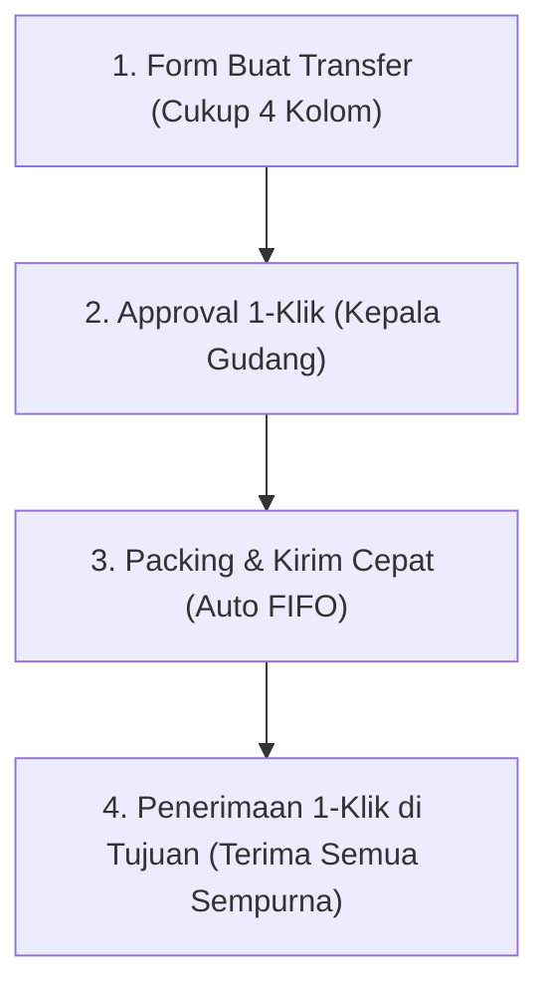

# Original User Request

## Parameters
[skip-interview]
How this run was launched; not part of the task.

## Initial Request — 2026-10-31T12:09:24Z

saya ingin anda mengerjakan rekomendasi revisi di bawah ini

Berdasarkan penelusuran menyeluruh pada kode sumber backend (`StockTransferController`, `StockTransferService`, `StoreStockTransferRequest`), model data, dan antarmuka Blade (`create`, `packing`, `ship`, `receive`, `show`), berikut adalah analisis mendalam mengenai titik-titik kelemahan UX & validasi saat ini, serta **rekomendasi solusi konkret agar fitur transfer stok ini menjadi mudah, cepat, dan tidak ribet digunakan**.

---

### A. Titik Masalah Utama pada UX & Validasi Saat Ini

#### 1. Form Pembuatan Transfer (`/warehouse/stock-transfers/create`)
- **Tabel 10 Kolom yang Terlalu Penuh & Membingungkan**:
  - Kolom saat ini: *Produk, Satuan, Qty Diminta, Qty Disetujui, Lokasi Ambil (Bin), Batch HPP, Harga Jual Tujuan, Lokasi Tujuan (Bin), Catatan, Aksi*.
  - **Qty Diminta vs Qty Disetujui**: Pembuat transfer (staf/toko) dipaksa mengisi dua kolom ini secara manual. Padahal saat pembuatan, Qty Disetujui adalah wewenang approver (Kepala Gudang) saat tahap persetujuan.
  - **Batch HPP Manual**: Pemohon transfer dipaksa memilih ID Batch stok bertingkat via multi-select, padahal GudangToko sudah memiliki mekanisme *Auto FIFO*.
  - **Harga Jual Tujuan**: Ini formulir transfer logistik barang fisik; staf gudang sering bingung mengapa harus mengisi harga jual baru di cabang tujuan.
  - **Lokasi Rak/Bin Tujuan**: Pengirim di gudang asal dipaksa menentukan produk harus ditaruh di rak/bin mana di cabang tujuan, padahal yang tahu ketersediaan rak tujuan adalah staf di lokasi tujuan saat barang tiba.
- **Deadlock Validasi (Ayam vs Telur) pada Pencarian Produk**:
  - Di `StockTransferController::locationOptions`, pencarian produk di-hardcode wajib mengirim `warehouse_location_id` (Lokasi Ambil).
  - Jika user belum memilih dropdown "Lokasi Ambil Default" di atas, Select2 produk **macet/tidak memuat data sama sekali** tanpa pesan error yang jelas bagi orang awam.
- **Umpan Balik Validasi Tidak Spesifik**:
  - Jika ada kesalahan pada baris ke-4 (misal bin kosong), form hanya menampilkan banner umum di bagian bawah: *"Periksa kembali form. Minimal satu produk harus diisi..."*, tanpa menandai baris mana yang salah.

#### 2. Form Penerimaan Barang di Cabang (`/retail/stock-transfers/{id}/receive`)
- **Tidak Ada Tombol Cepat "Terima Semua"**:
  - Jika transfer memuat 15 item dan semua barang tiba dalam kondisi bagus, staf toko penerima harus mengetik satu per satu atau membiarkan form tanpa tombol verifikasi cepat.
- **Kalkulasi Selisih Manual & Rawan Error**:
  - User harus menghitung sendiri pembagian antara *Qty Diterima*, *Qty Rusak*, dan *Qty Selisih*. Jika `Diterima + Rusak + Selisih > Sisa Dikirim`, form langsung ditolak backend tanpa panduan visual di layar.

#### 3. Fragmentasi Alur Kerja
- Proses transfer terbagi ke 5 tahapan terpisah di halaman berbeda (`create` &rarr; `approve` di `show` &rarr; `packing` &rarr; `ship` &rarr; `receive`), namun tombol aksi berikutnya (*Next Step*) sering kali tenggelam di sidebar atau bagian bawah halaman, sehingga staf bingung "dokumen ini sekarang harus diapakan lagi?".

---

### B. Konsep Solusi: Bagaimana Membuat Fitur Ini Simpel & Nyaman?

Agar fitur ini profesional, cepat, dan tidak membebani staf lapangan, berikut rekomendasi perbaikan berbasis prinsip **Smart Defaults & Progressive Disclosure**:

---

### C. Rencana Perbaikan Detail per Halaman

#### 1. Halaman Buat Transfer (`create.blade.php`) &mdash; *Fokus: Ringkas & Cepat*
1. **Sederhanakan Tabel Item menjadi Hanya 4 Kolom Utama**:
   - **Kolom 1: Produk & Satuan** (dilengkapi preview stok tersedia di lokasi sumber: misal *Stok: 45 Pcs*).
   - **Kolom 2: Jumlah Transfer** (hanya 1 input kuantitas!). Sistem secara otomatis menetapkan `quantity_approved = quantity_requested` di latar belakang.
   - **Kolom 3: Lokasi Rak/Bin Sumber (Opsional)**: Default menggunakan rak utama/otomatis.
   - **Kolom 4: Tombol Hapus Baris**.
2. **Sembunyikan/Otomatiskan Field Teknis**:
   - **Batch HPP**: Gunakan **Auto-FIFO** secara default. Staf tidak perlu pusing memilih batch manual kecuali membuka opsi lanjutan (*Advanced Mode*).
   - **Lokasi Rak Tujuan**: Dikosongkan di awal; biarkan staf penerima yang menentukan rak/bin saat barang tiba.
   - **Harga Jual Tujuan**: Otomatis mengikuti aturan harga aktif di cabang tujuan.
3. **Hilangkan Syarat Kaku Pemilihan Rak Sebelum Pilih Produk**:
   - User dapat langsung memilih produk terlebih dahulu. Jika lokasi asal memiliki rak default, sistem langsung mengaitkannya secara otomatis.
4. **Validasi Interaktif di Sisi Browser (Real-Time)**:
   - Cegah pemilihan Lokasi Tujuan yang sama dengan Lokasi Sumber langsung di dropdown.
   - Validasi stok langsung di baris input: jika user mengetik angka `50` padahal stok hanya `45`, input langsung bergaris merah dengan teks *"Melebihi stok tersedia (45 Pcs)"* dan tombol submit otomatis dinonaktifkan secara aman.

#### 2. Halaman Penerimaan Barang (`receive.blade.php`) &mdash; *Fokus: Efisiensi Kasir/Staf Toko*
1. **Tombol "1-Klik: Terima Semua Sesuai Pengiriman"**:
   - Sekali klik, seluruh baris otomatis terisi: `Qty Diterima = Sisa Dikirim`, `Qty Rusak = 0`, `Qty Selisih = 0`. Staf bisa langsung konfirmasi terima dalam hitungan detik jika barang sesuai.
2. **Kalkulator Selisih Otomatis**:
   - Jika staf menginput `Qty Rusak: 2`, maka sistem otomatis mengurangi `Qty Diterima = Dikirim - 2`. Staf tidak perlu menghitung manual di kalkulator.
3. **Indikator Visual Status Barang**:
   - Kartu ringkasan hijau jika semua cocok, atau kuning/merah jika ada selisih sebelum dokumen disimpan.

#### 3. Halaman Detail Transfer (`show.blade.php`) &mdash; *Fokus: Kejelasan Siapa Mengerjakan Apa*
1. **Kartu "Aksi Utama Sekarang" di Paling Atas**:
   - Tampilkan kartu tombol aksi besar di bagian paling atas yang disesuaikan dengan peran user yang sedang login:
     - Jika status *Pending Approval* dan user adalah Kepala Gudang: tombol hijau mencolok **"Setujui Transfer"**.
     - Jika status *Shipped* dan user adalah Petugas Toko Tujuan: tombol biru mencolok **"Proses Terima Barang"**.
2. **Ringkasan Qty Lebih Ringkas**:
   - Menggabungkan kolom tabel yang berlebihan (saat ini ada 9 kolom kuantitas: *Diminta, Disetujui, Diambil, Kurang, Dikirim, Diterima, Rusak, Selisih, In-Transit*) menjadi visual status yang lebih bersih (contoh: *Dikirim: 20 &rarr; Diterima: 18 (2 Rusak)*).

---

### Catatan Tambahan Alur & Konteks Proyek:
- Selesai mengerjakan, jalankan `vendor/bin/pint --test`, `vendor/bin/phpstan analyse`, dan `php artisan test --filter=StockTransferWorkflowTest`.
- Lakukan `git add`, `git commit`, dan `git push origin main`.

## Follow-up — 2026-10-31T12:10:20Z

Persyaratan dan detail teknis sudah lengkap dan final sesuai uraian spesifikasi di atas. Silakan langsung mulai eksekusi perbaikan kode dan antarmuka.
