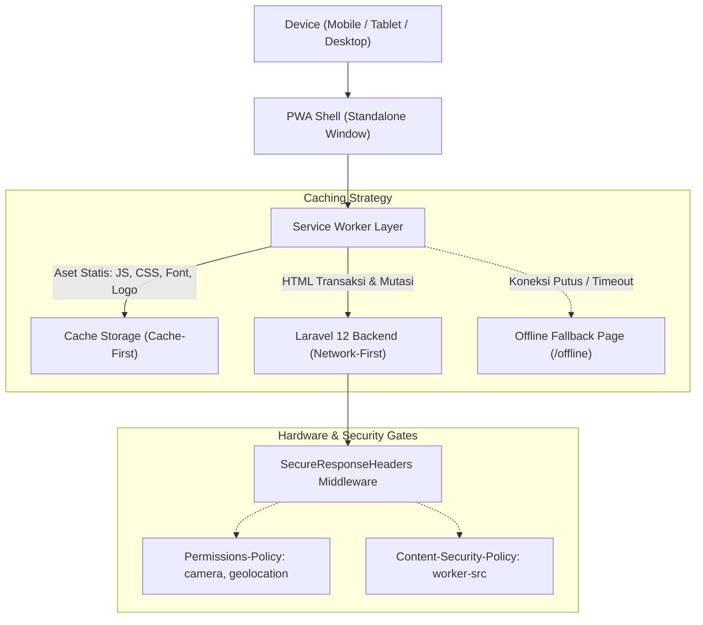
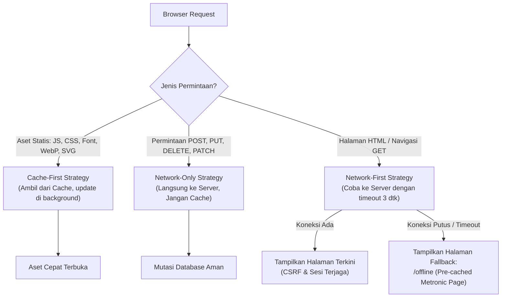
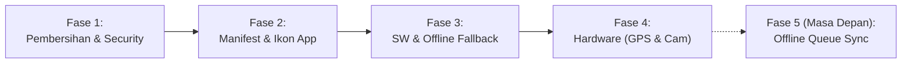

# Analisis Komprehensif Kesiapan PWA (Progressive Web App) — GudangToko

> **Status Analisis**: *Selesai Dilakukan (Fase Perencanaan & Audit Arsitektur)*  
> **Target Aplikasi**: GudangToko (`gudangtoko/application`) — Laravel 12, Blade SSR, Bootstrap 5, Metronic 8, Vite 7.  
> **Prinsip**: *Tidak melakukan instalasi langsung; fokus pada analisis kelayakan, identifikasi kendala/risiko, dan perancangan arsitektur.*

---

## 1. Ringkasan Eksekutif & Temuan Historis

Pemasangan PWA pada aplikasi GudangToko memiliki nilai strategis yang sangat tinggi, terutama untuk modul **Kasir (Retail POS)**, **Presensi & Checklist Kerja Karyawan**, **Operasional Gudang (Opname & Transfer via Mobile)**, serta **Approval Pemilik/Owner**.

Namun, dari audit mendalam terhadap riwayat repositori dan codebase aktual, ditemukan **fakta historis penting**:
> [!WARNING] Catatan Historis Kode (Commit `10823e0`)
> Pada tanggal 26 September 2026, fitur PWA dan Service Worker sebelumnya **dilepas/dicabut** dari `resources/views/layouts/metronic/app.blade.php` dan digantikan dengan script pembersihan paksa:
> ```javascript
> if ('serviceWorker' in navigator) {
>     navigator.serviceWorker.getRegistrations().then(registrations => {
>         for (const reg of registrations) reg.unregister();
>     });
> }
> if ('caches' in window) {
>     caches.keys().then(keys => keys.forEach(k => caches.delete(k)));
> }
> ```
> **Penyebab umum kegagalan PWA pada aplikasi Laravel Monolith SSR (Blade):**
> 1. **Cache HTML yang Agresif** mengakibatkan token `@csrf` usang, sehingga form transaksi memicu error `419 Page Expired`.
> 2. **Stale Data Sesi & Otorisasi**: Perubahan lokasi kerja (`WorkLocation`) atau pergantian shift kasir tidak ter-update karena browser menampilkan HTML dari cache lama.
> 3. **Pembaruan Aplikasi Terhalang**: Browser pengguna menahan file JS/CSS lama yang terkunci di Service Worker (*worker lifecycle trap*).

Oleh karena itu, implementasi PWA baru **tidak boleh asal pasang plugin generik**, melainkan harus dirancang dengan arsitektur pemisahan ketat antara **Aset Statis (Cache-First)** dan **HTML Transaksional (Network-First + Offline Fallback)**.

---

## 2. Audit Kesiapan Infrastruktur & Arsitektur Aplikasi



### 2.1. Frontend & Mobile Responsiveness
- **Kondisi Saat Ini**: Sangat Siap. 
- Berdasarkan berkas `resources/css/app.css` dan pengujian otomatis di `tests/Unit/Views/ResponsiveMobileLayoutTest.php`, aplikasi telah memiliki standarisasi styling mobile untuk breakpoint `< 767.98px` (kontrol input, form-select, modal dialog, select2, flatpickr, datatables, dan offcanvas).
- Komponen tabel di hampir seluruh modul telah dibungkus dengan container `.table-responsive`.

### 2.2. Asset Bundling & Versi Build
- Menggunakan **Vite 7** (`vite.config.js`) dengan plugin Tailwind v4 dan Laravel Vite Plugin.
- Output build di `public/build/assets/` menggunakan penamaan *content-hash* otomatis (misal: `app-abc123.js`, `app-xyz456.css`). Hal ini sangat menguntungkan Service Worker karena aset statis hasil kompilasi kebal terhadap masalah stale-cache.

### 2.3. Audit Keamanan & Header HTTP (Blocker Ditemukan)
Ditemukan 2 konfigurasi keamanan yang **wajib disesuaikan** sebelum PWA dapat berfungsi:

1. **Permissions-Policy Terlalu Restriktif**:
   Di file [app/Http/Middleware/SecureResponseHeaders.php](file:///c:/laragon/www/super-app-pos/app/Http/Middleware/SecureResponseHeaders.php#L36):
   ```php
   'Permissions-Policy' => 'camera=(), microphone=(), geolocation=()',
   ```
   > [!CAUTION] Blocker Fungsional
   > Header ini mematikan total akses **kamera** dan **geolocation (GPS)** dari browser. Jika PWA ingin memanfaatkan scan barcode via kamera (POS/Gudang) dan validasi lokasi presensi GPS karyawan, header ini harus diubah menjadi:
   > `'Permissions-Policy' => 'camera=(self), microphone=(), geolocation=(self)'`

2. **CSP Directive untuk Service Worker**:
   Di [config/security.php](file:///c:/laragon/www/super-app-pos/config/security.php#L8-L19), belum ada deklarasi eksplisit untuk `worker-src`. Jika CSP diaktifkan secara ketat (`report_only = false`), browser akan memblokir registrasi Service Worker. Harus ditambahkan:
   ```php
   "worker-src 'self' blob:",
   ```

### 2.4. Deployment & Sinkronisasi Server Produksi (cPanel)
Di script [scripts/sync-cpanel-after-pull.sh](file:///c:/laragon/www/super-app-pos/scripts/sync-cpanel-after-pull.sh#L37-L41):
```bash
cp -a "$APP_DIR/public/assets/." "$PUBLIC_DIR/assets/"
cp -a "$APP_DIR/public/build/." "$PUBLIC_DIR/build/"
cp "$APP_DIR/public/.htaccess" "$PUBLIC_DIR/.htaccess"
```
Jika file `manifest.webmanifest`, `sw.js`, dan icon PWA diletakkan di root direktori `public/`, skrip deployment di atas harus diperbarui agar file-file PWA di root `public/` ikut disinkronkan ke document root cPanel.

---

## 3. Analisis Dampak & Manfaat per Modul Aplikasi

| Modul | Pengguna Utama | Benefit PWA | Rekomendasi Mode Offline |
|---|---|---|---|
| **Retail POS (Kasir)** | Kasir Toko | • Tampilan layar penuh (*standalone*) tanpa bilah alamat browser.<br>• Mencegah tab tertutup tidak sengaja saat melayani pelanggan.<br>• Akses print struk thermal lebih ringkas.<br>• Waktu muat awal instan. | **Online-First + Fallback Cerdas**.<br>POS mengelola cart di browser, namun validasi stok FIFO dan pencatatan kas shift wajib realtime di server untuk mencegah *overselling* (stok minus). |
| **Attendance (Presensi)** | Karyawan Semua Cabang | • Karyawan dapat meng-install app di smartphone pribadi.<br>• Akses kamera selfie untuk bukti kehadiran.<br>• Akses GPS untuk radius lokasi kerja.<br>• Checklist kerja harian langsung dari saku. | **Network-First**.<br>Presensi wajib dicatat dengan validasi waktu server agar tidak terjadi kecurangan waktu (manipulasi jam HP). |
| **Warehouse (Gudang)** | Kepala & Staff Gudang | • Fleksibel dibawa ke lorong rak barang (Stock Opname, Pengecekan Rak/Bin, Inbound Penerimaan Barang).<br>• Scan barcode produk menggunakan kamera smartphone. | **Network-First + Cached Product Lookup**.<br>Membaca katalog produk bisa di-cache, namun mutasi fisik stok tetap Network-First. |
| **B2B / Langganan** | Pelanggan Grosir / B2B | • Pengalaman berbelanja layaknya aplikasi e-commerce native.<br>• Notifikasi status pengiriman & pesanan siap diambil. | **Stale-While-Revalidate untuk Katalog**,<br>Network-First untuk pembuatan Purchase Order. |
| **Owner / Approver** | Pemilik & Manajer | • Approval cepat (Inbox PO, Opname Variance, Penyesuaian Harga) dari smartphone tanpa login berulang. | **Network-First**.<br>Data finansial sensitif tidak boleh tersimpan permanen di cache publik device. |

---

## 4. Perancangan Strategi Caching Service Worker (Anti-419)

Kunci sukses PWA pada aplikasi Laravel Monolith adalah **aturan routing cache yang presisi**:



### Detail Kebijakan Cache:
1. **Cache-First (Static Pre-Cache)**:
   - File build Vite: `/build/assets/*`
   - Vendor assets Metronic: `/assets/vendor/*`, `/assets/media/logos/*`
   - Web fonts: Google Inter fonts & Keenthemes font icons (`ki-icons-fallback.css`)
   - Halaman khusus offline: `/offline`
2. **Network-First dengan Timeout Pendek (HTML Navigation)**:
   - Semua route `GET` aplikasi internal (`/dashboard`, `/retail/pos`, `/warehouse/stocks`, dll).
   - Jika dalam 2,5 detik server merespons, sajikan HTML segar dan perbarui cache navigasi.
   - Jika offline atau timeout, sajikan `/offline`.
   - **TIDAK MENYIMPAN FORM HTML LAMA** guna menjamin token `@csrf` tidak basi.
3. **Network-Only (Strict Bypass)**:
   - Rute auth: `/login`, `/logout`.
   - Semua endpoint mutasi: POST/PUT/DELETE (`/retail/pos/checkout`, `/warehouse/stock-opnames/*`, dll).
   - Export file: `/reports/export/*`, PDF/Excel invoice generator.

---

## 5. Komponen Blueprint PWA yang Akan Dibuat

Jika nantinya Anda memutuskan untuk memasang PWA, berikut adalah arsitektur komponen yang akan dibangun (tanpa menginstal sekarang):

```
gudangtoko/
├── public/
│   ├── manifest.webmanifest          # Definisi nama aplikasi, warna tema, shortcuts, display mode
│   ├── sw.js                         # Service Worker dengan strategi caching terstruktur
│   └── assets/media/pwa/             # Ikon aplikasi:
│       ├── icon-192x192.png          # Ikon Android standard
│       ├── icon-512x512.png          # Ikon splash screen & desktop
│       ├── icon-maskable-512x512.png # Ikon adaptive Android (lingkaran/squircle)
│       └── apple-touch-icon.png      # Ikon khusus iOS Safari
├── resources/views/
│   ├── pwa/
│   │   └── offline.blade.php         # Tampilan ramah pengguna saat jaringan terputus
│   └── layouts/metronic/
│       ├── app.blade.php             # Link manifest, meta iOS, registrasi sw.js (hapus unregister lama)
│       └── partials/
│           ├── pwa-install-banner.blade.php  # Banner promosi install non-intrusif
│           └── pwa-update-toast.blade.php    # Toast "Versi Baru Tersedia -> Muat Ulang"
```

### Fitur Pintasan Aplikasi (App Shortcuts) pada Manifest:
Saat icon aplikasi ditekan lama (*long press*) di Android/iOS, pengguna langsung dapat memilih:
1. 🛒 **Kasir POS** (`/retail/pos`)
2. 🕒 **Presensi Shift** (`/attendance/check`)
3. 📦 **Cek Stok Barang** (`/warehouse/stocks`)
4. 📬 **Kotak Approval** (`/control/inbox`)

---

## 6. Rekomendasi Roadmap Implementasi Bertahap



1. **Fase 1 — Pembersihan & Konfigurasi Keamanan (Prasyarat)**:
   - Bersihkan script unregister & cache delete di [app.blade.php](file:///c:/laragon/www/super-app-pos/resources/views/layouts/metronic/app.blade.php#L61-L76) dan `auth.blade.php`.
   - Perbaiki `Permissions-Policy` di [SecureResponseHeaders.php](file:///c:/laragon/www/super-app-pos/app/Http/Middleware/SecureResponseHeaders.php#L36) (`camera=(self), geolocation=(self)`).
   - Tambahkan `worker-src 'self' blob:` pada CSP di [config/security.php](file:///c:/laragon/www/super-app-pos/config/security.php#L8-L19).
   - Tambahkan sinkronisasi file PWA di [scripts/sync-cpanel-after-pull.sh](file:///c:/laragon/www/super-app-pos/scripts/sync-cpanel-after-pull.sh).

2. **Fase 2 — Web App Manifest & Branding Ikon**:
   - Generate aset ikon PNG beresolusi tinggi (192px, 512px, maskable) dari logo GudangToko.
   - Buat `public/manifest.webmanifest` dengan shortcuts modul penting.
   - Pasang tag `<link rel="manifest">` dan meta tag Apple Mobile Web App di Blade layout.

3. **Fase 3 — Service Worker & Offline Fallback UX**:
   - Buat `resources/views/pwa/offline.blade.php` dengan desain Metronic yang elegan (tombol "Coba Sambungkan Ulang").
   - Susun `public/sw.js` dengan strategi: Pre-cache aset statis + Network-First untuk halaman Blade.
   - Tambahkan update listener agar pengguna mendapat notifikasi toast saat ada deployment baru.

4. **Fase 4 — Integrasi Hardware (Opsional & Bertahap)**:
   - Aktifkan barcode scanner via kamera Web API di POS / Stok Opname.
   - Aktifkan deteksi GPS koordinat pada presensi shift karyawan.

---

## 7. Kesimpulan & Rekomendasi

Aplikasi **GudangToko sangat layak dan diuntungkan dengan kehadiran PWA**, terutama untuk meningkatkan efisiensi kasir toko dan mobilitas staf gudang/karyawan di lapangan.

Namun, implementasi **TIDAK BOLEH** menggunakan pendekatan Full-Offline transaksional di awal karena dapat merusak integritas data finansial dan stok FIFO. Pendekatan terbaik adalah **App Shell Caching + Network-First Transaksional + Offline Fallback Cerdas**, yang memberikan kecepatan layaknya aplikasi native tanpa risiko error `419 CSRF Token Expired` atau selisih stok fisik.
