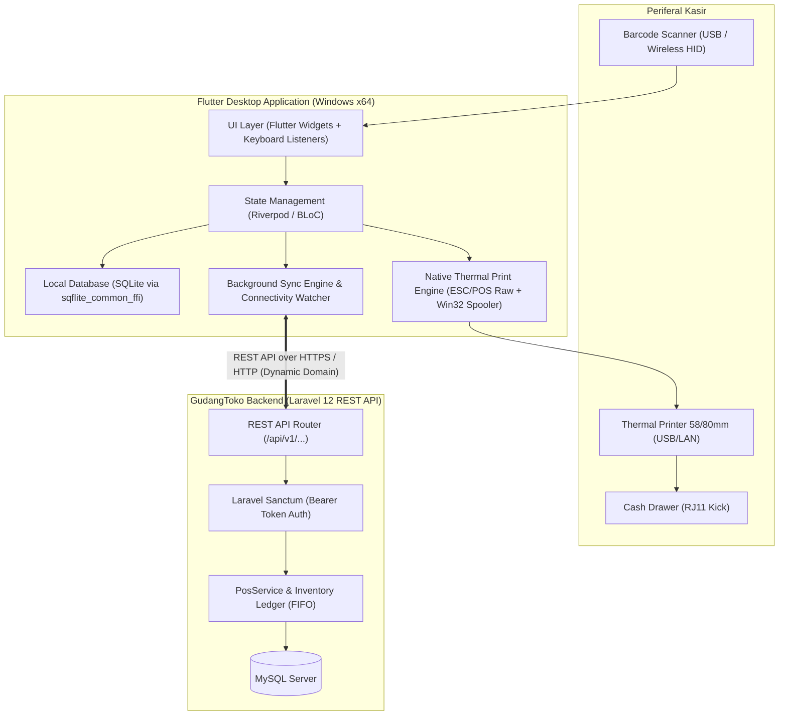
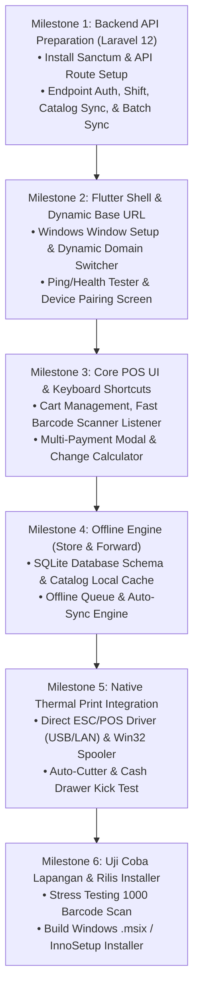

# Product Requirements Document (PRD) & Spesifikasi API  
## Aplikasi Kasir Desktop Ringan (Flutter Windows x64) — GudangToko

---

## 1. Ringkasan Eksekutif & Tujuan Produk

Aplikasi **GudangToko POS Desktop** adalah aplikasi kasir berbasis **Flutter Desktop (Windows 10/11 x64)** yang dirancang untuk menggantikan ketergantungan penuh pada antarmuka web browser di meja kasir ritel. Aplikasi ini berfokus pada:
1. **Kecepatan & Performa Ekstrem**: Konsumsi memori sangat rendah (~60–120 MB RAM vs Electron 400+ MB), waktu boot awal < 2 detik, respon scanning barcode produk < 10 milidetik.
2. **Kemandirian Jaringan (Full Offline Mode — Store & Forward)**: Kasir tetap dapat melakukan scan barang, menghitung total, menerima pembayaran, dan mencetak struk secara offline saat koneksi internet toko putus. Transaksi disimpan dalam antrean lokal SQLite dan otomatis disinkronkan ke server pusat saat online.
3. **Konfigurasi Domain Dinamis (Flexible Environment)**: Pengaturan alamat server (*Base URL*) dapat diganti dengan mudah antara *Production*, *Staging*, atau *Lokal LAN Toko* langsung dari antarmuka login/pengaturan tanpa perlu kompilasi ulang kode.
4. **Integrasi Hardware Kasir Native**: Direct RAW ESC/POS thermal printing (USB, LAN/Ethernet, Bluetooth) dengan pemotong kertas otomatis (*auto-cutter*) dan tendangan laci uang (*cash drawer kick*), serta dukungan fallback Windows Print Spooler.
5. **Navigasi Keyboard Kasir 100%**: Dirancang untuk kecepatan kasir tanpa mouse menggunakan shortcut keyboard standar (F1–F12, Esc, Enter, tanda panah).

---

## 2. Arsitektur Sistem & Alur Konektivitas



---

## 3. Fitur Utama & Kebutuhan Fungsional

### 3.1. Konfigurasi Domain Dinamis & Tes Koneksi
- **Penyimpanan Alamat Server**: Tersimpan aman pada local encrypted configuration (`flutter_secure_storage`).
- **Antarmuka Pengaturan Server**:
  - Tombol icon gir di pojok atas layar login (dan shortcut `Ctrl + Shift + S`).
  - Pilihan Preset Cepat:
    * `Production`: `https://app.gudangtoko.com`
    * `Staging`: `https://staging.gudangtoko.com`
    * `Lokal LAN`: `http://192.168.1.10:8000`
    * `Kustom URL`: Input manual `http(s)://...`
  - Tombol **"Uji Koneksi (Ping Server)"**: Memanggil `GET /api/v1/ping` untuk memvalidasi ketersediaan backend, latency, dan kompatibilitas versi API sebelum disimpan.
  - **Proteksi Akses**: Bebas diatur saat belum ada shift kasir yang terbuka; terkunci otomatis dengan verifikasi PIN Supervisor/Manager saat shift kasir sedang aktif.

### 3.2. Pemasangan Perangkat (Device Register Pairing) & Sesi Kasir
- **Pairing Terminal Kasir**:
  - Saat aplikasi pertama kali dipasang, Administrator melakukan *Pairing Register* sekali:
    * Memilih Cabang Toko (`Branch ID`).
    * Memberi nama/kode register terminal (contoh: `KASIR-01-DEPAN`).
    * Menghasilkan `device_id` (UUID v4 perangkat) yang disimpan permanen.
- **Login Pengguna Kasir**:
  - Kasir memasukkan username/email dan password.
  - Backend memvalidasi otorisasi `pos.view` dan `pos.create` serta mengeluarkan **Sanctum Personal Access Token** berumur panjang dengan refresh token.
- **Siklus Kas Shift (Cash Shift)**:
  - Buka Shift (`Open Shift`): Input modal awal kas laci (`starting_cash`).
  - Pengeluaran Kas Kecil Saat Shift Berjalan (`Petty Cash Expense`): Pencatatan uang keluar operasional (cth: beli lakban/kebersihan).
  - Tutup Shift (`Close Shift`): Input hitungan fisik kas akhir (*blind closing* / *reconciliation*), cetak rekap shift X/Z report.

### 3.3. Transaksi Penjualan & Scanning Barcode
- **Pencarian Cepat & Scan Barcode**:
  - Keyboard listener menangkap scan barcode USB HID dalam mode burst input.
  - Pencarian instan dari SQLite lokal (nama, SKU, barcode, brand, kategori) tanpa delay jaringan.
- **Katalog & Snapshot Harga**:
  - Mendukung multi-satuan unit (Pcs, Box, Dus).
  - Mendukung penyesuaian harga spesial pelanggan grosir (jika pelanggan terdaftar dipilih).
- **Manajemen Keranjang Belanja**:
  - Shortcut keyboard kasir:
    * `F1`: Fokus input scan barcode / cari barang.
    * `F2`: Ubah kuantitas item aktif (`+` / `-` / numeric input).
    * `F3`: Ubah diskon item / transaksi (persen atau nominal rupiah).
    * `F4`: Pilih pelanggan / cari member.
    * `F5`: Tahan transaksi (*Hold Bill*).
    * `F6`: Buka daftar transaksi tertahan (*Resume Bill*).
    * `F7`: Buka laci kasir manual (*Kick Drawer*).
    * `F8`: Catat kas keluar shift (*Petty Cash*).
    * `F10`: Bayar / Buka dialog pembayaran (*Checkout*).
    * `Esc`: Batalkan / Tutup dialog.
- **Metode Pembayaran**:
  - Tunai (Cash): Otomatis kalkulasi uang diterima dan kembalian, shortcut tombol pecahan uang cepat (Rp 10.000, Rp 20.000, Rp 50.000, Rp 100.000, Uang Pas).
  - Transfer Bank / QRIS Dinamis / Statis.
  - Kartu Debit / EDC (input nomor referensi nota EDC).
  - Piutang / Kredit Pelanggan B2B (dengan pengecekan sisa limit piutang & jatuh tempo).
  - Multi-Payment (Kombinasi Tunai + Transfer/Kredit).

### 3.4. Mode Offline Penuh (Store & Forward) & Sinkronisasi
- **Deteksi Konektivitas**:
  - Background periodic heartbeat setiap 15 detik ke endpoint `/api/v1/ping`.
  - Indikator status visual di pojok atas: `Hijau (Online & Synced)`, `Kuning (Online, Ada Transaksi Mengantre)`, `Merah (Mode Offline)`.
- **Penyimpanan Transaksi Offline**:
  - Setiap checkout dalam kondisi offline langsung menghasilkan:
    * `client_transaction_id`: UUID v4 unik.
    * `temporary_offline_number`: Nomor faktur sementara format `OFF/{BRANCH}/{REGISTER}/{TIMESTAMP}`.
    * Struk thermal tetap dicetak dengan label jelas: `*STRUK OFFLINE - TERSIMPAN DI PERANGKAT*`.
- **Auto-Sync Engine**:
  - Saat koneksi internet kembali pulih (`online`), engine otomatis mengirim transaksi secara batch (`POST /api/v1/pos/sync/sales`).
  - **Idempotency Guard**: Jika kiriman sempat terputus di tengah jalan, backend menggunakan `client_transaction_id` agar tidak terjadi pencatatan ganda.
  - **Aturan Bisnis Selisih Stok (Force Sync Audit)**:
    * Transaksi offline tetap dicatat sah sebagai mutasi penjualan resmi.
    * Flag audit `offline_synced = true` disematkan pada transaksi dan mutasi stok.
    * Jika stok di server sudah habis saat sinkronisasi, sistem mencatat mutasi penyesuaian (*stock adjustment*) dengan status `auto_opname_needed` untuk direview oleh Kepala Toko/Gudang.

### 3.5. Direct Thermal Printing (ESC/POS & Spooler)
- Pengaturan lebar kertas: `58mm` (32 kolom) atau `80mm` (42/48 kolom).
- Mode koneksi printer:
  1. **USB Direct RAW / Win32 Spooler**: Mengirim bytes mentah ESC/POS langsung ke printer port tanpa memicu dialog Windows.
  2. **Network / LAN (TCP/IP Port 9100)**: Cocok untuk printer kasir atau dapur via kabel Ethernet/Wi-Fi.
  3. **Bluetooth**: Mendukung printer kasir portable SPP/RFCOMM.
- Opsi Cetak:
  - Header: Nama Perusahaan, Alamat Cabang, Nomor Telepon, Nomor Struk, Nama Kasir, Waktu.
  - Item List: Nama, Qty × Harga, Diskon, Subtotal.
  - Summary: Total Belanja, Diskon Global, PPN (jika ada), Grand Total, Bayar, Kembalian.
  - Footer: Pesan Terima Kasih, Kebijakan Retur Toko, QR Code verifikasi faktur.
  - Hardware Commands: `ESC p` (Kick Drawer), `GS V` (Cut Paper).

---

## 4. Spesifikasi Kontrak REST API Endpoint Backend (Laravel 12)

Semua endpoint API diletakkan di bawah prefix:  
`{{BASE_URL}}/api/v1`  
Header wajib pada setiap permintaan API:
```http
Accept: application/json
Content-Type: application/json
Authorization: Bearer <SANCTUM_PERSONAL_ACCESS_TOKEN>
X-Device-Id: <DEVICE_UUID>
X-App-Version: 1.0.0
```

---

### 4.1. Modul Sistem, Ping & Autentikasi

#### `GET /api/v1/ping`
*Tujuan: Memverifikasi konektivitas, latensi server, dan status domain dinamis.*
- **Auth**: Publik (Tanpa Token).
- **Response `200 OK`**:
```json
{
  "status": "ok",
  "app_name": "GudangToko",
  "version": "1.0.0",
  "server_time": "2026-11-18T11:15:00+07:00",
  "environment": "staging"
}
```

#### `POST /api/v1/auth/login`
*Tujuan: Login kasir dan mengembalikan Sanctum Bearer Token.*
- **Auth**: Publik.
- **Request Body**:
```json
{
  "login": "kasir_toko1",
  "password": "password",
  "device_id": "9b1deb4d-3b7d-4bad-9bdd-2b0d7b3dcb6d",
  "device_name": "PC-KASIR-01"
}
```
- **Response `200 OK`**:
```json
{
  "token": "1|qX8Wz9yL7vK3...",
  "user": {
    "id": 5,
    "name": "Siti Kasir",
    "username": "kasir_toko1",
    "roles": ["kasir"],
    "permitted_branches": [
      { "id": 1, "code": "TKO-PUSAT", "name": "Toko Internal Pusat" }
    ]
  }
}
```

#### `POST /api/v1/auth/logout`
*Tujuan: Mencabut token sesi kasir.*
- **Auth**: Bearer Token.
- **Response `200 OK`**:
```json
{ "message": "Sesi berhasil diakhiri." }
```

---

### 4.2. Modul Kas Shift (Cash Shift)

#### `GET /api/v1/pos/shifts/current`
*Tujuan: Mendapatkan status shift kasir yang sedang aktif di cabang/register.*
- **Response `200 OK` (Shift Sedang Buka)**:
```json
{
  "has_active_shift": true,
  "shift": {
    "id": 142,
    "branch_id": 1,
    "branch_name": "Toko Internal Pusat",
    "cashier_user_id": 5,
    "cashier_name": "Siti Kasir",
    "opened_at": "2026-11-18 08:00:00",
    "starting_cash": "200000.00",
    "total_sales_cash": "1450000.00",
    "total_expenses": "35000.00",
    "current_expected_cash": "1615000.00",
    "status": "open"
  }
}
```
- **Response `200 OK` (Belum Buka Shift)**:
```json
{
  "has_active_shift": false,
  "shift": null
}
```

#### `POST /api/v1/pos/shifts/open`
*Tujuan: Membuka shift kasir baru dengan modal kas awal.*
- **Request Body**:
```json
{
  "branch_id": 1,
  "starting_cash": 200000,
  "notes": "Modal awal pecahan 5k, 10k, 20k"
}
```
- **Response `201 Created`**:
```json
{
  "message": "Shift kasir berhasil dibuka.",
  "shift_id": 143
}
```

#### `POST /api/v1/pos/shifts/close`
*Tujuan: Menutup shift kasir dengan rekonsiliasi kas fisik (Blind Closing).*
- **Request Body**:
```json
{
  "shift_id": 143,
  "actual_cash_amount": 1615000,
  "closing_notes": "Selesai shift pagi, kas cocok."
}
```
- **Response `200 OK`**:
```json
{
  "message": "Shift kasir berhasil ditutup.",
  "summary": {
    "expected_cash": "1615000.00",
    "actual_cash": "1615000.00",
    "difference": "0.00",
    "status": "closed"
  }
}
```

#### `POST /api/v1/pos/shifts/expenses`
*Tujuan: Mencatat pengeluaran kas kecil saat shift aktif.*
- **Request Body**:
```json
{
  "shift_id": 143,
  "amount": 25000,
  "expense_category": "operasional",
  "notes": "Beli isi ulang lakban packing"
}
```
- **Response `201 Created`**:
```json
{ "message": "Pengeluaran kas shift berhasil dicatat." }
```

---

### 4.3. Modul Master Data & Snapshot Katalog Offline

#### `GET /api/v1/pos/catalog/sync`
*Tujuan: Mengunduh snapshot lengkap master produk, harga, kategori, dan pelanggan untuk cache offline.*
- **Query Params**:
  * `branch_id`: `1` (Wajib)
  * `updated_after`: `2026-11-18T00:00:00Z` (Opsional, untuk delta sync)
- **Response `200 OK`**:
```json
{
  "sync_timestamp": "2026-11-18T11:20:00+07:00",
  "categories": [
    { "id": 1, "name": "Sembako", "slug": "sembako" }
  ],
  "brands": [
    { "id": 3, "name": "Indofood" }
  ],
  "customers": [
    {
      "id": 12,
      "code": "CUST-0012",
      "name": "Toko Berkah Abadi",
      "customer_type": "b2b",
      "credit_limit": "5000000.00",
      "outstanding_receivable": "1200000.00",
      "available_credit": "3800000.00"
    }
  ],
  "products": [
    {
      "id": 101,
      "sku": "BRG-MINYAK-01",
      "barcode": "8992345678901",
      "name": "Minyak Goreng 2 Liter",
      "category_id": 1,
      "brand_id": 3,
      "unit_id": 2,
      "unit_name": "Pouch",
      "stock_on_hand": 85.0000,
      "available_stock": 85.0000,
      "standard_price": "34000.00",
      "min_sale_price": "32000.00",
      "has_multi_units": false,
      "units": [
        { "unit_id": 2, "name": "Pouch", "conversion_factor": 1.0, "price": "34000.00" }
      ]
    }
  ]
}
```

---

### 4.4. Modul Transaksi Penjualan (Realtime Checkout)

#### `POST /api/v1/pos/checkout`
*Tujuan: Memproses pembayaran kasir saat online dengan validasi stok & pembuatan nomor faktur resmi.*
- **Request Body**:
```json
{
  "client_transaction_id": "9b1deb4d-3b7d-4bad-9bdd-2b0d7b3dcb6d",
  "branch_id": 1,
  "customer_id": null,
  "idempotency_key": "IDEMP-20261118-00142-9981",
  "items": [
    {
      "product_id": 101,
      "unit_id": 2,
      "quantity": 2,
      "selected_price": 34000,
      "discount_percent": 0
    }
  ],
  "payments": [
    {
      "method": "cash",
      "amount": 100000,
      "reference_no": null
    }
  ],
  "notes": ""
}
```
- **Response `201 Created`**:
```json
{
  "message": "Transaksi berhasil disimpan.",
  "sale": {
    "id": 894,
    "number": "POS/TKO-PUSAT/2026/00894",
    "client_transaction_id": "9b1deb4d-3b7d-4bad-9bdd-2b0d7b3dcb6d",
    "subtotal": "68000.00",
    "discount_amount": "0.00",
    "grand_total": "68000.00",
    "paid_amount": "100000.00",
    "change_amount": "32000.00",
    "created_at": "2026-11-18 11:22:10",
    "cashier": "Siti Kasir",
    "customer": "Pelanggan Umum"
  }
}
```

---

### 4.5. Modul Batch Sync Transaksi Offline (Store & Forward)

#### `POST /api/v1/pos/sync/sales`
*Tujuan: Menerima kumpulan transaksi yang terjadi saat kasir dalam mode offline untuk dicatat massal ke database.*
- **Request Body**:
```json
{
  "branch_id": 1,
  "device_id": "9b1deb4d-3b7d-4bad-9bdd-2b0d7b3dcb6d",
  "sales": [
    {
      "client_transaction_id": "e6a2b841-8f5c-4e89-a541-1f92e07123aa",
      "offline_number": "OFF/TKO-PUSAT/KASIR-01/1731903000",
      "created_at": "2026-11-18 09:30:00",
      "customer_id": null,
      "items": [
        {
          "product_id": 101,
          "unit_id": 2,
          "quantity": 1,
          "selected_price": 34000,
          "discount_percent": 0
        }
      ],
      "payments": [
        {
          "method": "cash",
          "amount": 50000,
          "reference_no": null
        }
      ]
    }
  ]
}
```
- **Response `200 OK`**:
```json
{
  "total_received": 1,
  "synced_count": 1,
  "results": [
    {
      "client_transaction_id": "e6a2b841-8f5c-4e89-a541-1f92e07123aa",
      "status": "synced",
      "official_sale_number": "POS/TKO-PUSAT/2026/00895",
      "offline_number": "OFF/TKO-PUSAT/KASIR-01/1731903000",
      "stock_status": "adjusted_ok"
    }
  ]
}
```

---

### 4.6. Modul Tahan Transaksi (Hold & Resume Bill)

#### `GET /api/v1/pos/holds`
*Tujuan: Mengambil daftar transaksi tertahan milik kasir aktif.*
- **Response `200 OK`**:
```json
{
  "holds": [
    {
      "id": 24,
      "number": "HLD-20261118-001",
      "customer_name": "Pak Budi",
      "item_count": 3,
      "estimated_total": "125000.00",
      "created_at": "10:15"
    }
  ]
}
```

#### `POST /api/v1/pos/holds`
*Tujuan: Menyimpan transaksi sementara ke antrean hold.*
- **Request Body**:
```json
{
  "customer_id": null,
  "customer_name": "Pak Budi",
  "cart_snapshot": { ... }
}
```

---

## 5. Rencana Arsitektur & Paket Flutter Desktop

Untuk memastikan aplikasi **sangat ringan dan stabil di Windows**, arsitektur project Flutter diatur sebagai berikut:

### 5.1. Struktur Layering Clean Architecture
```
lib/
├── core/
│   ├── config/          # Environment & Dynamic Base URL manager
│   ├── constants/       # Keyboard shortcut bindings, theme colors
│   ├── network/         # Dio client, connectivity interceptor, token refresh
│   └── database/        # SQLite database helper (sqflite_common_ffi)
├── features/
│   ├── auth/            # Login, Device Pairing, Sanctum Session
│   ├── server_config/   # Dynamic Domain switcher, Ping & Health tester
│   ├── pos_terminal/    # Main Cashier Screen, Cart, Barcode scan parser
│   ├── shift/           # Open Shift, Close Shift, Petty Cash Dialogs
│   ├── payment/         # Multi-payment modal, Change calculator
│   ├── sync/            # Offline queue worker, Auto-sync daemon
│   └── printing/        # Direct ESC/POS engine, Win32 spooler adapter
└── main.dart            # Windows WindowManager init (min size: 1024x768)
```

### 5.2. Pilihan Package Pustaka Flutter (Dependencies)
| Keperluan | Rekomendasi Package | Alasan & Keunggulan |
|---|---|---|
| **Networking** | `dio` + `connectivity_plus` | Dukungan interceptor, dynamic base URL update realtime, deteksi offline status. |
| **Local Database** | `sqflite_common_ffi` | Standard SQLite murni untuk Windows Desktop, cepat, ACID compliant, memory footprint kecil. |
| **State Management** | `flutter_riverpod` | Reaktif, testable, compile-safe, tanpa boilerplate berat. |
| **Window Control** | `window_manager` | Mengatur window Windows desktop (fullscreen toggle, min size 1024x768, title bar kustom). |
| **Thermal Printing** | `flutter_pos_printer_platform` / `esc_pos_utils_plus` | Direct byte generator ESC/POS untuk printer thermal USB, LAN socket, dan Bluetooth. |
| **Win32 Spooler** | `win32` | Akses native Windows Print Spooler API untuk printer thermal yang hanya terdeteksi via driver Windows. |
| **Storage Kredensial** | `flutter_secure_storage` | Menyimpan token Sanctum & Device ID dengan enkripsi DPAPI Windows. |

---

## 6. Non-Functional Requirements & Standar Kualitas

1. **Performa & Konsumsi Sumber Daya**:
   - RAM Usage di Windows: **< 120 MB** pada beban normal kasir seharian.
   - CPU Usage saat idle: **0% - 1%**.
   - Cold Start Time: **< 2.0 detik** hingga siap menerima scan pertama.
2. **Keandalan Data (Data Integrity)**:
   - Setiap transaksi offline wajib memiliki UUID dan disimpan dalam SQLite transaction blok sebelum mencetak struk fisik.
   - Transaksi yang berstatus `pending_sync` tidak boleh hilang meskipun PC kasir mati mendadak atau listrik padam.
3. **Ergonomi Kasir**:
   - Seluruh alur mulai dari input barang, ubah qty, pilih pembayaran tunai, dan cetak struk harus dapat diselesaikan **100% tanpa menyentuh mouse**.

---

## 7. Roadmap Pelaksanaan Pengembangan


