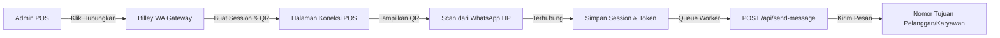

# Integrasi WhatsApp Gateway (Billey WA)

Aplikasi memakai gateway WhatsApp berbasis Baileys (**Billey WA**) yang terhubung ke server `https://jokiin35.web.id`. Super Admin dan Admin Config mengelolanya melalui menu **Koneksi WhatsApp** (`/admin/integrasi/whatsapp`). Token API dan sesi disimpan secara aman di database dan tidak pernah diekspos ke browser pengguna.

## Arsitektur & Endpoint Gateway (`https://jokiin35.web.id`)

Gateway Billey WA menyediakan endpoint REST API berbasis Bearer Token:

1. **Pembuatan Sesi Baru / Guest Session**:
   - `POST https://jokiin35.web.id/api/guest-session/create`
   - Menghasilkan `sessionId` unik (misal `guest_watoken...`), `apiToken` (misal `WATOKEN-...`), dan status awal `connecting`.
2. **Pemeriksaan Status & Kode QR**:
   - `GET https://jokiin35.web.id/api/guest-session/{sessionId}/status`
   - Header: `Authorization: Bearer {apiToken}`
   - Mengembalikan status (`qr_ready`, `connected`, `connecting`, `disconnected`), string QR code untuk dipindai, serta metadata akun (`phoneNumber`, `pushName`).
3. **Penyegaran QR Code**:
   - `POST https://jokiin35.web.id/api/guest-session/{sessionId}/refresh-qr`
   - Header: `Authorization: Bearer {apiToken}`
4. **Pemutusan Sesi (Disconnect / Logout)**:
   - `DELETE https://jokiin35.web.id/api/guest-session/{sessionId}`
   - Header: `Authorization: Bearer {apiToken}`
5. **Pengiriman Pesan WhatsApp**:
   - `POST https://jokiin35.web.id/api/send-message`
   - Header: `Authorization: Bearer {apiToken}`, `Content-Type: application/json`
   - Payload:
     ```json
     {
       "session_id": "guest_watoken...",
       "to": "628xxxxxxxxxx",
       "message": "Isi pesan notifikasi"
     }
     ```
   - Mengembalikan `{"success": true, "msg_id": "..."}` jika terhubung. Jika sesi belum terhubung/dipindai, gateway mengembalikan HTTP 409 `{"success": false, "error": "Session belum connected."}`.
6. **Daftar Sesi Aktif**:
   - `GET https://jokiin35.web.id/api/sessions`

## Konfigurasi `.env`

Tambahkan / sesuaikan pada `.env` aplikasi GudangToko:

```env
WA_GATEWAY_ENABLED=true
WA_GATEWAY_BASE_URL=https://jokiin35.web.id
WA_GATEWAY_API_KEY=
WA_GATEWAY_SESSION_ID=gudangtoko-main
WA_GATEWAY_TIMEOUT=15
NOTIFICATION_DRY_RUN=false
```

> **Catatan:** Jika `WA_GATEWAY_API_KEY` tidak diisi manual di `.env`, aplikasi otomatis membuat guest session dinamis via `POST /api/guest-session/create` dan menyimpan `api_token` beserta `session_id` langsung ke tabel `whatsapp_connections`.

## Menjalankan Antrean Notifikasi

Untuk memproses notifikasi keluar di latar belakang, jalankan queue worker:

```powershell
php artisan queue:work database --queue=default --tries=3 --timeout=120
```

Worker queue wajib aktif agar pesan berstatus **Dalam Antrian** diproses. Halaman Koneksi WhatsApp menampilkan 10 pengiriman terbaru langsung dari server, lalu memperbarui status antrean, percobaan ulang, gagal, serta terkirim secara otomatis.

## Alur Kerja



## Pemecahan Masalah

- **Gateway tidak dapat dijangkau:** Pastikan server `https://jokiin35.web.id` aktif dan koneksi internet stabil.
- **QR kedaluwarsa:** Klik tombol **Minta QR Baru / Sambungkan Ulang**.
- **Sesi terputus di HP:** Klik **Putuskan WhatsApp**, lalu klik **Hubungkan WhatsApp** untuk membuat sesi baru.
- **Pesan gagal / HTTP 409:** Pastikan WhatsApp sudah berstatus **Terhubung** sebelum mengirim pesan. Periksa Log Pengiriman dan Kesehatan Sistem.
