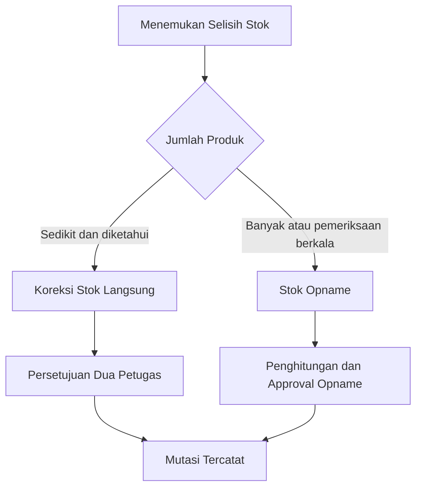

# Panduan Koreksi Stok Terkendali

Panduan ini digunakan oleh `super_admin`, `kepala_gudang`, dan `kepala_toko`. Fitur Koreksi Stok Langsung dipakai ketika jumlah fisik satu atau beberapa produk berbeda dari saldo sistem dan koreksi tidak perlu menunggu stock opname menyeluruh.

Koreksi memakai **jumlah fisik akhir**. Pengguna tidak mengetik penambahan atau pengurangan bebas. Sistem menghitung selisih, menyimpan snapshot, lalu memperbarui stok hanya setelah disetujui petugas kedua.

## 1. Pembagian tanggung jawab

| Role | Tanggung jawab |
|---|---|
| Super Admin | Mengaktifkan akses per lokasi dan menjadi penyetuju cadangan. |
| Kepala Gudang | Membuat atau menyetujui koreksi pada gudang penugasannya. |
| Kepala Toko | Membuat atau menyetujui koreksi pada toko penugasannya. |

Staff Gudang, Picker Packer, Staf Toko, Kasir, dan role lain tidak dapat membuat koreksi langsung. Pembuat dokumen tidak dapat menyetujui dokumennya sendiri.

## 2. Mengaktifkan akses lokasi

Super Admin membuka `/admin/settings/stock-adjustment-access`, memilih toko atau gudang, lalu mengisi waktu mulai, waktu berakhir, dan alasan. Setelah batas waktu terlewati, akses terkunci otomatis.

```guide-flow
stock-adjustment-access
```

Aktivasi, perpanjangan, dan penonaktifan disimpan pada histori akses dan audit log. Menonaktifkan akses tidak mengubah dokumen yang sudah selesai.

## 3. Membuat koreksi stok

Kepala lokasi membuka `/warehouse/stock-adjustments`, memilih lokasi penugasannya, lalu menambahkan produk yang akan dikoreksi. Setiap item wajib mempunyai stok fisik final dan catatan penyebab selisih.

```guide-flow
stock-direct-adjustment-create
```

Jumlah fisik tidak boleh negatif atau lebih kecil dari gabungan stok reserved dan rusak. Produk yang tidak mempunyai selisih tidak dapat dimasukkan sebagai koreksi.

## 4. Persetujuan dua petugas

Dokumen berstatus **Menunggu Persetujuan** diperiksa oleh kepala bagian lain pada lokasi yang sama. Jika lokasi hanya mempunyai satu kepala, Super Admin dapat menjadi penyetuju kedua.

```guide-flow
stock-direct-adjustment-approval
```

Jika transaksi lain mengubah stok setelah dokumen diajukan, sistem memperbarui snapshot dan mengembalikan dokumen ke draft. Pembuat harus memeriksa target fisik dan mengajukannya kembali.

## 5. Posting stok dan jejak audit

Ketika disetujui, seluruh item diproses dalam satu transaksi database. Jika satu item gagal, tidak ada item yang berubah.

```guide-flow
stock-direct-adjustment-posting
```

Mutasi menyimpan saldo sebelum, perubahan, saldo sesudah, nomor dokumen, pembuat, penyetuju, target fisik, dan catatan. Koreksi tidak mengubah HPP produk dan tidak memengaruhi stok darurat.

## 6. Arti status dokumen

| Status | Arti |
|---|---|
| Draft | Masih dapat diperiksa dan diperbarui oleh pembuat. |
| Menunggu Persetujuan | Isi terkunci dan menunggu petugas kedua. |
| Selesai | Persetujuan berhasil dan mutasi stok sudah dibuat. |
| Ditolak | Penyetuju menolak dengan alasan. Stok tidak berubah. |
| Dibatalkan | Pembuat atau Super Admin membatalkan dokumen yang belum selesai. |

## 7. Pemeriksaan setelah koreksi

1. Buka detail dokumen dan pastikan status **Selesai**.
2. Periksa saldo sebelum dan sesudah pada setiap item.
3. Buka Kartu Stok menggunakan nomor referensi koreksi.
4. Periksa nama pembuat, penyetuju, target fisik, catatan, dan waktu mutasi.
5. Gunakan ekspor CSV jika diperlukan untuk rekonsiliasi.

Dokumen selesai dan mutasi tidak dapat diedit atau dihapus. Jika ditemukan kesalahan baru, buat dokumen koreksi baru agar jejak perubahan tetap utuh.

## 8. Kapan memakai stock opname

Gunakan Koreksi Stok Langsung untuk selisih produk tertentu yang sudah diketahui. Gunakan **Stok Opname** untuk penghitungan berkala, pemeriksaan banyak produk, blind count, atau pemeriksaan seluruh zona/rak/bin.


