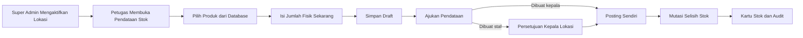
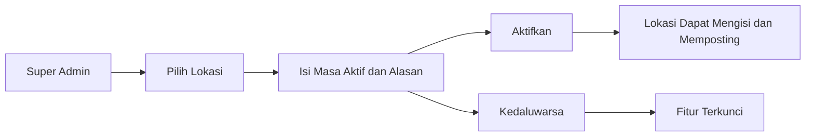
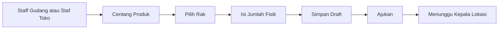
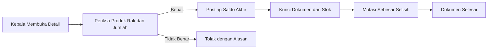
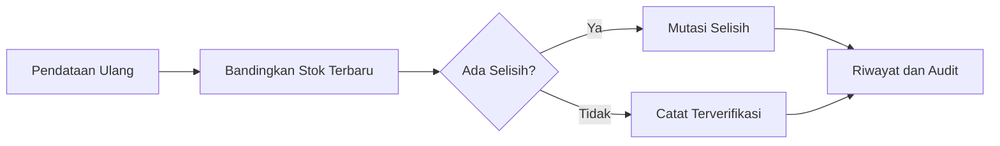

# Panduan Pendataan Stok Lokasi

## Tujuan

Pendataan Stok Lokasi digunakan untuk memasukkan jumlah barang yang benar-benar ada di toko atau gudang berdasarkan produk yang sudah tersedia di database. Fitur ini menjadi alternatif import stok awal menggunakan Excel.

Jumlah yang dimasukkan adalah **saldo akhir hasil hitung fisik**, bukan jumlah tambahan. Jika stok sistem 20 dan fisik 27, sistem mencatat +7. Jika fisik 15, sistem mencatat -5.

## Alur utama

## Mengaktifkan lokasi

Super Admin membuka **Administrasi Sistem > Akses Koreksi Stok**, memilih lokasi, lalu mengisi masa aktif dan alasan. Akses terkunci otomatis ketika kedaluwarsa.

## Staf mencatat stok

1. Buka **Persediaan > Pendataan Stok Lokasi**.
2. Pilih lokasi penugasan dan gunakan dropdown pencarian untuk memilih banyak produk sekaligus.
3. Gunakan **Pilih Semua Hasil Filter** bila seluruh hasil pencarian akan dihitung.
4. Terapkan satu rak ke semua produk atau tentukan rak berbeda per baris.
5. Isi **Jumlah Fisik Sekarang**. Angka 0 digunakan bila produk sudah diperiksa tetapi kosong.
6. Simpan satu draft massal lalu ajukan.

## Pemeriksaan dan posting

Kepala Gudang memeriksa gudang dan Kepala Toko memeriksa cabang. Kepala dapat membuat dan memposting dokumennya sendiri; sistem mencatat posting mandiri tersebut sebagai audit kritis.

Jika stok berubah setelah pengajuan, dokumen kembali menjadi Draft agar jumlah diperiksa dan diajukan ulang.

## Pendataan ulang

Pendataan ulang diperbolehkan dan selalu membuat dokumen baru. Jumlah yang sama dicatat sebagai hasil verifikasi tanpa membuat mutasi kuantitas.

## Perbedaan fitur

| Fitur | Kegunaan |
|---|---|
| Pendataan Stok Lokasi | Input kondisi fisik langsung berdasarkan produk database. |
| Import Data Awal | Input massal melalui Excel oleh Super Admin. |
| Koreksi Stok | Memperbaiki selisih operasional. |
| Stok Opname | Pemeriksaan stok berkala. |

HPP dibaca dari master produk dan tidak dapat diubah oleh petugas. Stok darurat tidak termasuk dalam pendataan ini.
