# Panduan Target dan Bonus Setiap Pengguna

Panduan ini menjelaskan siapa yang menentukan target, data apa yang dinilai, bagaimana nilai setiap akun dihitung, siapa yang memeriksa, dan kapan bonus dapat dibayar. Buka menu **Target & Bonus** atau URL `/target-bonus`.

## 1. Gambaran singkat sistem

Owner Pengelola menentukan program sebelum bulan dimulai. Sistem membuat satu hasil bonus untuk setiap akun yang dipilih. Selama bulan berjalan, nilai diperbarui dari transaksi, absensi, dan checklist. Setelah bulan selesai, kepala bagian menyetujui hasil dan petugas berwenang mencatat pembayaran.

```guide-flow
bonus-program-setup
```

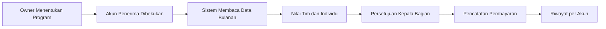

## 2. Siapa melakukan apa

| Pengguna | Tugas dalam sistem bonus |
|---|---|
| Owner Pengelola | Membuat program, menentukan target, bobot, penerima, dan bonus maksimum sebelum periode dimulai. Owner juga dapat mencatat pembayaran. |
| Super Admin | Akses administratif cadangan untuk mengelola program, persetujuan, pembayaran, dan pemeriksaan data. |
| Kepala Gudang | Melihat tim gudang serta menyetujui hasil Staff Gudang dan Picker/Packer pada gudang penugasannya. |
| Kepala Toko | Melihat tim toko serta menyetujui hasil Staf Toko dan Kasir pada cabang penugasannya. |
| Supervisor Shift | Memantau Staf Toko dan Kasir pada cabang, tetapi bukan penyetuju akhir bonus. |
| Staff Gudang, Picker/Packer, Staf Toko, Kasir, Sales | Melihat target, progres, rincian KPI, estimasi bonus, status persetujuan, dan pembayaran milik akun sendiri. |
| Owner Viewer | Membaca rekap seluruh organisasi tanpa mengubah program atau keputusan. |

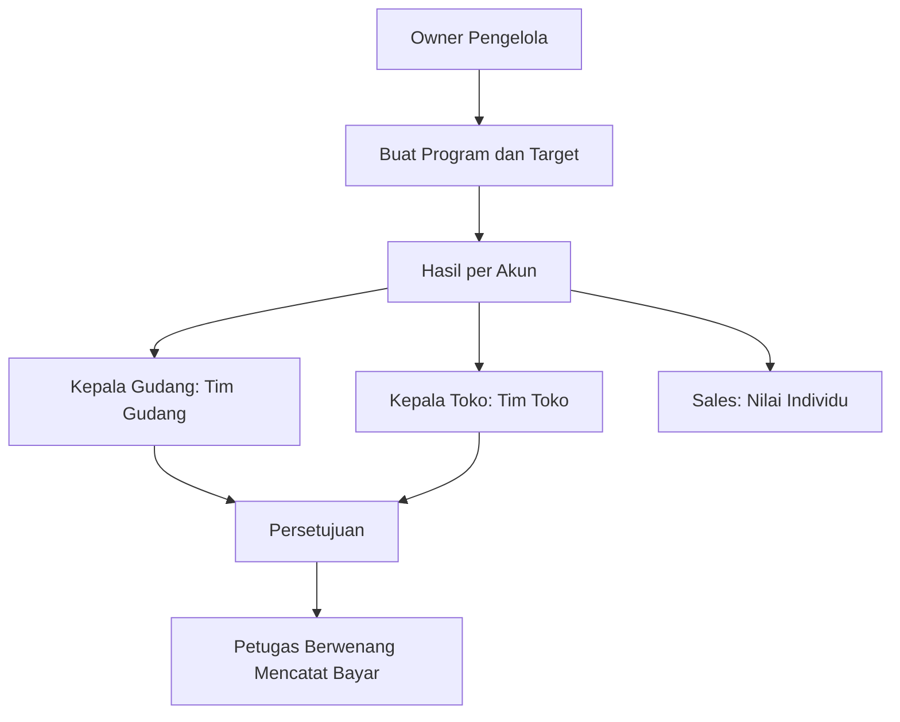

Untuk program Sales global, backend saat ini menggunakan **Kepala Gudang** sebagai kepala bagian persetujuan karena belum tersedia role Kepala Sales. Super Admin tetap menjadi akses administratif cadangan.

## 3. Target dibuat per role, lokasi, dan akun

Satu program hanya berlaku untuk satu role dan satu bulan. Program Staff Gudang dan Picker/Packer wajib memilih gudang. Program Staf Toko dan Kasir wajib memilih cabang. Program Sales memakai lingkup global.

Owner memilih akun penerima secara langsung. Dua staf dengan role dan lokasi sama belum tentu sama-sama menerima bonus jika salah satunya tidak dimasukkan ke program.

Owner juga dapat memberikan dua pengecualian per akun:

- **Target khusus** mengganti target KPI utama akun tersebut;
- **Bonus maksimum khusus** mengganti batas bonus maksimum program untuk akun tersebut.

Target khusus hanya berlaku pada KPI utama: pekerjaan gudang untuk staf gudang/picker, penjualan POS untuk staf toko/kasir, dan penjualan B2B untuk Sales.

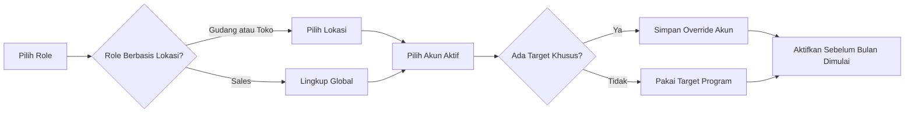

Program aktif tidak dapat diubah. Role, lokasi utama, penerima, KPI, target, bobot, dan bonus maksimum disimpan sebagai snapshot agar histori tidak berubah ketika data karyawan berubah.

## 4. KPI setiap role

### Staff Gudang dan Picker/Packer

| KPI | Lingkup | Bobot awal | Data yang dihitung backend |
|---|---|---:|---|
| Pekerjaan gudang selesai | Tim lokasi | 40% | Jumlah penerimaan yang diposting, transfer yang selesai, dan opname yang selesai pada gudang selama periode. |
| Akurasi pekerjaan gudang | Tim lokasi | 20% | Persentase kuantitas transfer tanpa selisih pada gudang. Jika tidak ada kuantitas transfer selesai, aktualnya 0. |
| Kehadiran terverifikasi | Individu | 20% | Hari hadir berstatus disetujui dibanding jadwal wajib akun. Izin, sakit, dan cuti yang disetujui dikeluarkan dari hari wajib. |
| Checklist tepat waktu | Individu | 20% | Checklist harian akun yang pertama kali selesai sebelum atau tepat pada tenggat. |

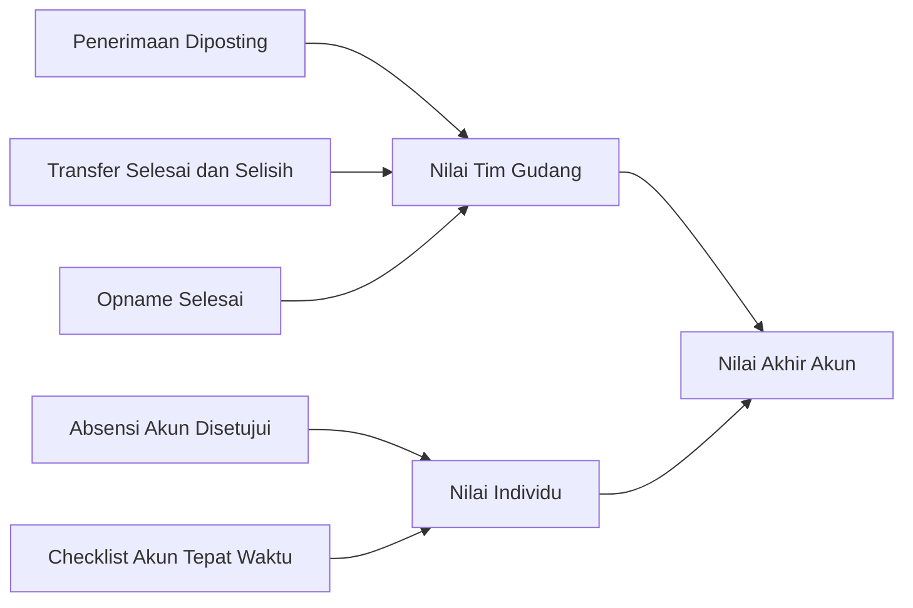

Nilai tim sama untuk seluruh penerima dalam program lokasi tersebut. Nilai absensi dan checklist dapat berbeda untuk setiap akun.

### Staf Toko dan Kasir

| KPI | Lingkup | Bobot awal | Data yang dihitung backend |
|---|---|---:|---|
| Penjualan POS bersih | Tim cabang | 50% | Total POS selesai atau diretur, dikurangi retur POS selesai pada cabang selama periode. Transaksi void tidak dihitung. |
| Akurasi kas | Tim cabang | 10% | Persentase shift yang sudah disetujui dan selisih kas absolutnya tidak melebihi toleransi shift. Jika belum ada shift disetujui, aktualnya 0. |
| Kehadiran terverifikasi | Individu | 20% | Hari hadir disetujui dibanding jadwal wajib akun setelah izin resmi dikeluarkan. |
| Checklist tepat waktu | Individu | 20% | Checklist harian akun yang selesai tepat waktu. |

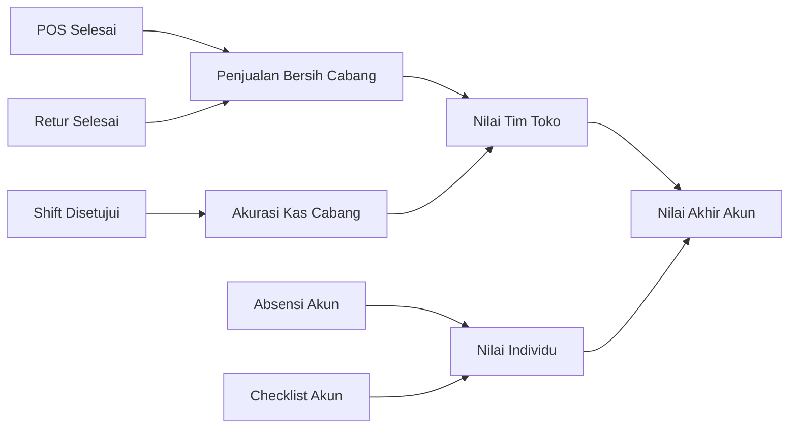

Omzet dan akurasi kas merupakan nilai tim cabang. Staf Toko dan Kasir dalam program yang sama memperoleh aktual tim yang sama, tetapi hasil akhirnya dapat berbeda karena kehadiran, checklist, target khusus, atau bonus maksimum khusus.

### Sales

| KPI | Lingkup | Bobot awal | Data yang dihitung backend |
|---|---|---:|---|
| Penjualan B2B bersih | Individu | 80% | Order B2B selesai dengan `sales_user_id` milik akun, dikurangi retur B2B berstatus settled yang terhubung ke order tersebut. |
| Kehadiran terverifikasi | Individu | 10% | Kehadiran disetujui dibanding jadwal wajib akun setelah izin resmi dikeluarkan. |
| Checklist tepat waktu | Individu | 10% | Checklist harian global milik akun yang selesai tepat waktu. |

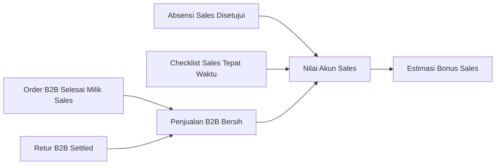

Seluruh KPI Sales bersifat individu. Penjualan Sales lain tidak menambah nilai akun tersebut.

## 5. Cara menghitung nilai setiap akun

```guide-flow
bonus-calculation
```

Rumus yang digunakan:

1. `Skor KPI = aktual ÷ target × 100`.
2. Skor setiap KPI dibatasi maksimal 100 dan tidak boleh negatif.
3. `Nilai berbobot = skor KPI × bobot ÷ 100`.
4. `Nilai akhir = jumlah seluruh nilai berbobot`.
5. `Bonus perhitungan = bonus maksimum akun × nilai akhir ÷ 100`.
6. Penyesuaian dari periode sebelumnya ditambahkan setelah bonus perhitungan. Hasil akhir tidak boleh kurang dari nol.

### Contoh perhitungan seorang Kasir

Misalnya bonus maksimum Kasir A adalah Rp1.000.000:

| KPI | Target | Aktual | Skor | Bobot | Nilai berbobot |
|---|---:|---:|---:|---:|---:|
| Penjualan POS bersih | Rp100.000.000 | Rp80.000.000 | 80 | 50% | 40 |
| Akurasi kas | 100% | 90% | 90 | 10% | 9 |
| Kehadiran | 100% | 95% | 95 | 20% | 19 |
| Checklist tepat waktu | 100% | 100% | 100 | 20% | 20 |
| **Total** |  |  |  | **100%** | **88** |

Bonus Kasir A adalah `Rp1.000.000 × 88 ÷ 100 = Rp880.000`.

Jika aktual penjualan mencapai 120% target, skor penjualan tetap 100. Sistem tidak memberikan bonus tambahan di atas bonus maksimum.

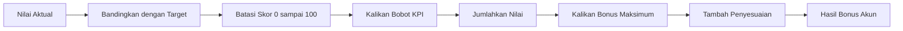

## 6. Mengapa nilai antar pengguna dapat berbeda

Dua akun dalam satu lokasi bisa memperoleh bonus berbeda karena:

- hanya salah satunya dipilih sebagai penerima program;
- target KPI utama atau bonus maksimum akun dioverride;
- jumlah hari wajib hadir dan absensi terverifikasi berbeda;
- ketepatan checklist harian berbeda;
- Sales mempunyai omzet B2B individual yang berbeda;
- terdapat penyesuaian dari pembayaran periode sebelumnya.

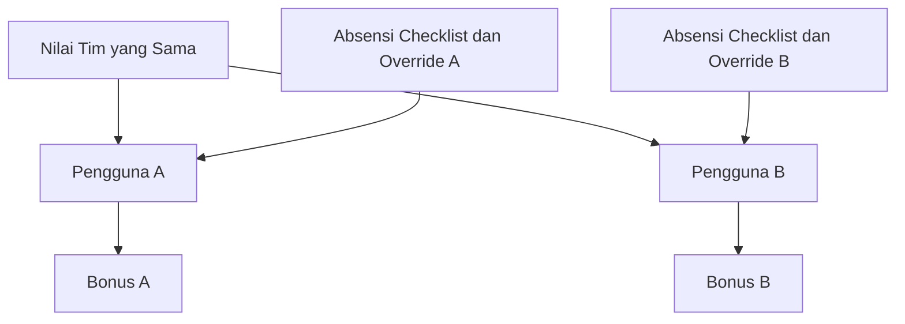

## 7. Cara staf membaca Target Saya

Pada tab **Target Saya**, setiap baris mewakili hasil satu akun untuk satu periode. Klik **Rincian** untuk membaca:

| Kolom | Arti |
|---|---|
| Lingkup Tim | Aktual berasal dari seluruh lokasi dan dipakai bersama oleh penerima program lokasi. |
| Lingkup Individu | Aktual hanya berasal dari akun yang sedang dilihat. |
| Target | Sasaran program atau target khusus akun. |
| Aktual | Hasil yang sudah terbaca dari transaksi aplikasi. |
| Skor | Persentase aktual terhadap target, maksimal 100. |
| Bobot | Besar pengaruh KPI terhadap nilai akhir. |
| Nilai | Skor yang sudah dikalikan bobot. |
| Estimasi bonus | Nilai sementara selama periode masih aktif. |
| Bonus disetujui | Nilai sudah dikunci melalui workflow persetujuan. |
| Dibayar | Pembayaran sudah memiliki tanggal, metode, dan referensi. |

```guide-flow
bonus-access-report
```

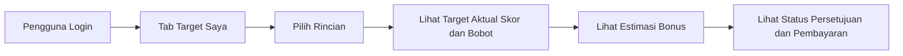

Estimasi dapat berubah selama periode aktif karena transaksi, retur, persetujuan absensi, atau checklist masih berjalan.

## 8. Penutupan dan persetujuan periode

Setelah bulan berakhir, pengelola menjalankan **Hitung Ulang** lalu **Ajukan**. Pengajuan ditolak jika masih ada absensi penerima berstatus menunggu verifikasi.

```guide-flow
bonus-approval
```

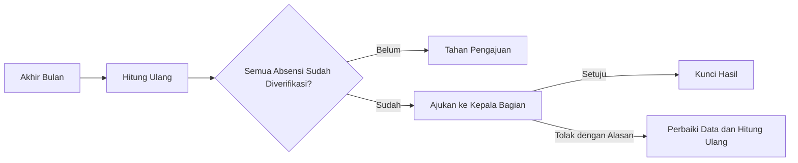

Kepala bagian tidak boleh menyetujui pengajuan yang dibuat oleh akun kepala tersebut sendiri jika pemisahan tugas pada approval aktif. Penolakan wajib disertai alasan. Hasil yang ditolak dapat dihitung dan diajukan kembali.

## 9. Pembayaran dan koreksi

```guide-flow
bonus-payment
```

Pembayaran hanya dapat dicatat setelah periode disetujui. Nominal pembayaran harus sama dengan nilai bonus yang disetujui. Tanggal, metode, dan nomor referensi wajib dicatat; bukti pembayaran bersifat opsional.

Pembayaran bonus tidak otomatis membuat payroll atau pengeluaran shift. Setelah semua penerima dibayar, periode menjadi ditutup. Bonus yang sudah dibayar tidak dapat dihapus. Jika ditemukan kesalahan, buat penyesuaian positif atau negatif pada hasil akun di periode berikutnya dengan alasan.

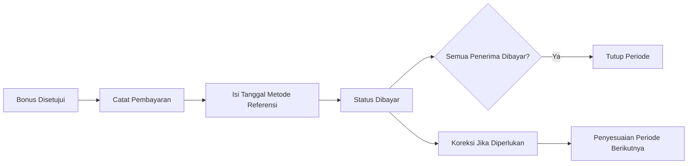

## 10. Checklist pemeriksaan per role

### Staf penerima bonus

- Pastikan akun, role, dan lokasi kerja sudah benar sebelum periode dimulai.
- Periksa tab Target Saya sejak awal bulan.
- Pastikan absensi pulang diverifikasi kepala lokasi.
- Selesaikan checklist harian sebelum tenggat.
- Laporkan transaksi atau nilai yang tidak terbaca sebelum periode diajukan.

### Kepala lokasi

- Periksa anggota tim dan lokasi pada tab Kinerja Tim.
- Selesaikan verifikasi absensi yang masih pending.
- Pastikan transaksi, retur, transfer, opname, dan shift kas sudah berstatus final.
- Bandingkan rincian aktual KPI dengan operasional lokasi.
- Setujui hanya setelah seluruh nilai dapat ditelusuri; tolak dengan alasan jika terdapat masalah.

### Owner Pengelola

- Buat program untuk bulan berikutnya sebelum tanggal satu.
- Pastikan total bobot tepat 100%.
- Pastikan akun tidak masuk ke dua program pada bulan yang sama.
- Gunakan target khusus hanya jika ada alasan bisnis yang jelas.
- Periksa rekap disetujui dan pembayaran seluruh akun.

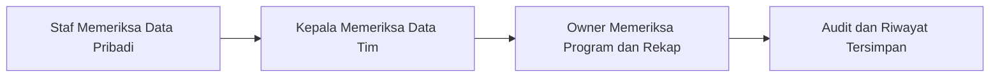

## 11. Catatan penting

- Program hanya dapat diaktifkan sebelum bulan target dimulai.
- Total bobot KPI wajib tepat 100%.
- Satu akun hanya boleh memiliki satu hasil bonus pada bulan yang sama.
- Perpindahan role atau lokasi setelah aktivasi tidak mengubah snapshot periode berjalan.
- Data Sales lama tetap tampil sebagai **Skema Lama** dan tidak dihitung ulang.
- Jangan mengubah transaksi sumber hanya untuk menaikkan bonus; aktivasi, perhitungan, keputusan, penyesuaian, dan pembayaran tercatat pada audit log.
